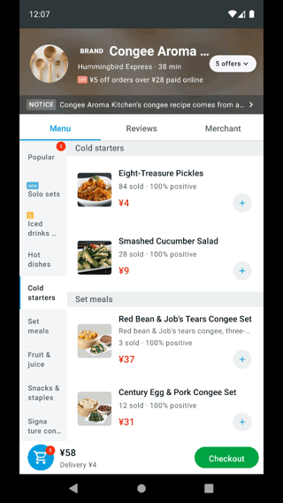

# shopping-rn

A React Native food-delivery app: browse the menu, build a cart, read reviews and
view the merchant — built with a modern RN stack and a Material Design 3 UI
(React Native Paper).

## Tech stack

| Area | Choice |
|---|---|
| Framework | React Native 0.81 (new architecture) + TypeScript |
| UI | React Native Paper 5 (Material Design 3), Material icons |
| Navigation | React Navigation 7 (native stack + material top tabs) |
| Server state | TanStack Query 5 |
| Client state | Zustand 5 + AsyncStorage persistence |
| Networking | axios + repository pattern |
| Testing | Jest + React Native Testing Library |
| Mock API | Express (`mock-server/`) |

## Architecture

Feature-based, with a one-way dependency flow:

```
src/
├── app/         # shell: providers, navigation, Paper theme, query client
├── core/        # config, http, storage, DI, errors
├── domain/      # entities + pure use-cases (no React, no axios)
├── data/        # DTOs, mappers, API services, repositories, fixtures
├── features/    # goods | cart | ratings | seller (screens, components, hooks, stores)
└── shared/      # reusable UI primitives
```

`domain` never imports from `data` or `features`; `features` depend on `domain` and
`data` through repository interfaces. See [ARCHITECTURE.md](./ARCHITECTURE.md) for the
full rationale.

## Run

Prerequisites: Node 20+, JDK 17, Android SDK; for iOS also Xcode and CocoaPods.

```bash
npm install

# iOS native dependencies (first run / after native dependency changes)
npm run pods

# Metro in one terminal
npm start

# app in another terminal
npm run android       # or: npm run ios
```

The app works without the mock API: if the request fails it falls back to the bundled
fixture. To serve the real endpoints instead:

```bash
npm run mock          # http://localhost:8900/api
```

Other useful commands: `npm test`, `npm run typecheck`, `npm run lint`.

## Demo



The GIF plays directly on GitHub. Full recording: [demo.mp4](docs/demo.mp4).

A short walkthrough of the menu, category navigation, cart, checkout dialog, reviews
and merchant screens.
